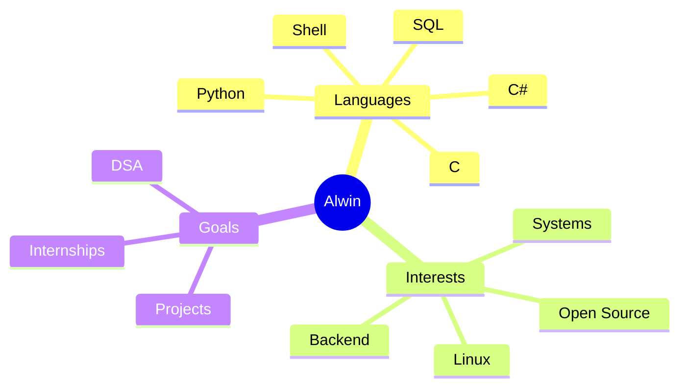
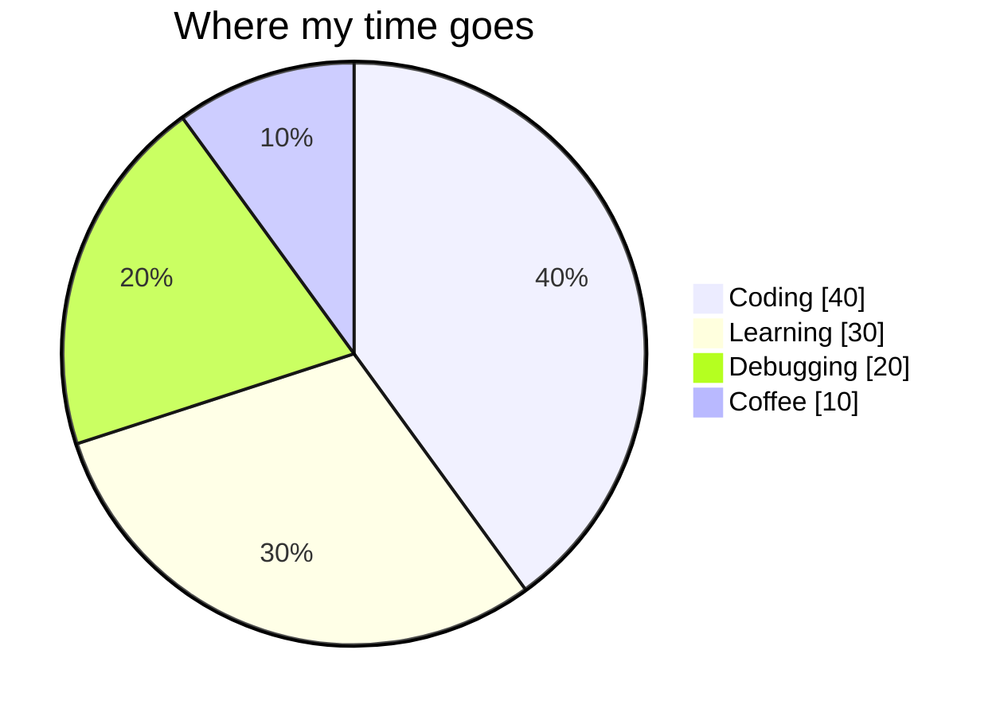

<!-- ═══════════════════════ HEADER ═══════════════════════ -->
<div align="center">


<a href="https://github.com/Alwin-sabu-2006">
  
</a>

<br/><br/>


<br/><br/>


</div>

<p align="center">
  <a href="#-about-me">About</a> •
  <a href="#-tech-stack">Stack</a> •
  <a href="#-featured-projects">Projects</a> •
  <a href="#-github-analytics">Stats</a> •
  <a href="#-learning-roadmap">Roadmap</a> •
  <a href="#-connect-with-me">Contact</a>
</p>


<!-- ═══════════════════════ TERMINAL ═══════════════════════ -->
<div align="center">
  
</div>


## 👾 About Me

<table>
<tr>
<td width="55%" valign="top">

```python
class Alwin:
    def __init__(self):
        self.name      = "Alwin Sabu"
        self.role      = "B.Tech CSE Student"
        self.college   = "SJCET, Palai"
        self.location  = "Kerala, India 🇮🇳"
        self.timezone  = "IST (UTC +5:30)"
        self.languages = ["C", "Python", "Shell", "C#", "SQL"]
        self.interests = ["Systems", "Backend", "Linux", "OSS"]
        self.currently = "Mastering fundamentals & building projects"
        self.motto     = "Always in debug mode 🐞"

    def say_hi(self):
        return "Let's build something great together!"
```

</td>
<td width="45%" valign="top">

### 🔭 Right now
- 🎓 Studying **Computer Science & Engineering**
- 🔬 Exploring low-level computing with **C**
- 🐧 Automating things with **Shell** on Ubuntu
- 🧠 Solving problems with **Python** & **C#**
- 🗄️ Sharpening **SQL** and query design
- 🌐 Contributing to the **open source** world

### ⚡ Fun facts
- 🐞 Debugging is my cardio
- ☕ Fuelled by coffee and curiosity
- 🧱 Believer in learning by building

</td>
</tr>
</table>


## 🧰 Tech Stack

<div align="center">


<br/><br/>

**💻 Languages**


**🛠️ Tools & Platforms**


<br/><br/>


<br/>


</div>


## 📁 Featured Projects

<div align="center">

<a href="https://github.com/Alwin-sabu-2006/PYTHON-PROGRAMMING-SJCET"></a>
<a href="https://github.com/Alwin-sabu-2006/C-programming"></a>
<a href="https://github.com/Alwin-sabu-2006/Shell-programming-in-ubuntu"></a>
<a href="https://github.com/Alwin-sabu-2006/sql"></a>
<a href="https://github.com/Alwin-sabu-2006/C-Hashtag-programming"></a>
<a href="https://github.com/Alwin-sabu-2006/learn-github-pages"></a>

</div>

<details>
<summary><b>🗂️ More from my learning journey (click to expand)</b></summary>
<br/>

| Repo | What's inside | Stack |
|:-----|:--------------|:------|
| 🌐 **[Html_practice](https://github.com/Alwin-sabu-2006/Html_practice)** | Small HTML components and layout designs |  |
| 🐍 **Python-coding** | Mini Python experiments and logic tasks |  |
| 📝 **[skills-communicate-using-markdown](https://github.com/Alwin-sabu-2006/skills-communicate-using-markdown)** | GitHub Skills: Markdown practice |  |
| 🧪 **[Github-Enablment-Task-_Assignment](https://github.com/Alwin-sabu-2006/Github-Enablment-Task-_Assignment)** | GitHub enablement assignment |  |

</details>


## 📈 GitHub Analytics

<div align="center">


<br/>


<br/>


<br/>


</div>


## 🏆 Trophy Cabinet

<div align="center">
  
</div>


## 🐍 Contribution Snake &nbsp;|&nbsp; 🧊 3D Contributions

> ⚙️ These two are generated by the GitHub Action in `.github/workflows/profile-animations.yml`. Run it once from the **Actions** tab to switch them on.

<div align="center">

<picture>
  <source media="(prefers-color-scheme: dark)" srcset="https://raw.githubusercontent.com/Alwin-sabu-2006/Alwin-sabu-2006/output/github-snake-dark.svg" />
  <source media="(prefers-color-scheme: light)" srcset="https://raw.githubusercontent.com/Alwin-sabu-2006/Alwin-sabu-2006/output/github-snake.svg" />
  
</picture>

<br/>


</div>


## 🗺️ Learning Roadmap

```mermaid
flowchart LR
    A[💻 C Basics] --> B[🐧 Shell Scripting]
    B --> C[🐍 Python]
    C --> D[🗄️ SQL]
    D --> E[🌐 Web Dev]
    E --> F[🧮 DSA]
    F --> G[⚙️ Backend Projects]
    G --> H[🚀 Internships & OSS]
    style A fill:#00ffe1,color:#000,stroke:#00ffe1
    style B fill:#00ffe1,color:#000,stroke:#00ffe1
    style C fill:#00ffe1,color:#000,stroke:#00ffe1
    style D fill:#ffd166,color:#000,stroke:#ffd166
    style E fill:#ffd166,color:#000,stroke:#ffd166
    style F fill:#ef476f,color:#fff,stroke:#ef476f
    style G fill:#ef476f,color:#fff,stroke:#ef476f
    style H fill:#7c4dff,color:#fff,stroke:#7c4dff
```



<table>
<tr>
<td width="50%" valign="top">



</td>
<td width="50%" valign="top">



</td>
</tr>
</table>

<details>
<summary><b>🎯 2026 Goals (click to expand)</b></summary>
<br/>

- [x] Build a strong base in **C** and **Python**
- [x] Get comfortable with **Shell scripting** on Ubuntu
- [ ] Master **Data Structures & Algorithms**
- [ ] Ship **3 full projects** with proper READMEs
- [ ] Make my first **open-source contribution**
- [ ] Land a **tech internship**

</details>


## 🧭 Code Motto

<div align="center">

```c
while (!Success) {
    Learn();
    Build();
    Commit();
    // Repeat. Never stop.
}
```


<br/>


</div>


## 🌐 Connect With Me

<div align="center">

<a href="https://www.linkedin.com/in/alwin-sabu-256540330/"></a>
<a href="mailto:alwinsabu540@gmail.com"></a>
<a href="https://github.com/Alwin-sabu-2006"></a>

<br/><br/>


<br/>


</div>
