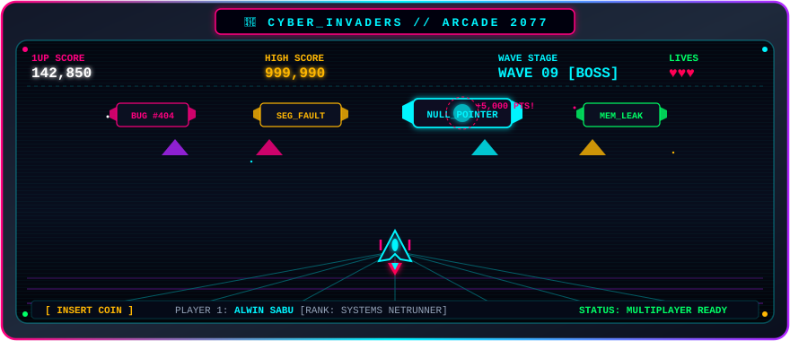
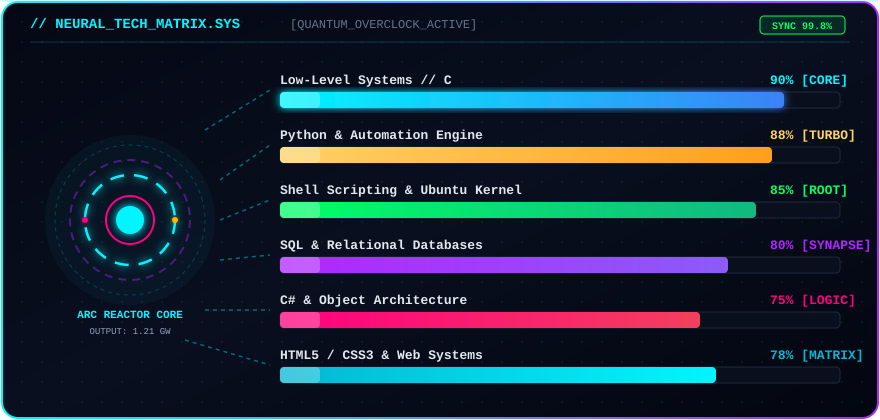
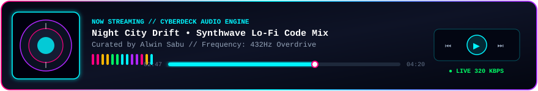

<!-- ═══════════════════════════════════════════════════════════════════ -->
<!--                     ALWIN SABU // NETRUNNER 2077                    -->
<!-- ═══════════════════════════════════════════════════════════════════ -->

<div align="center">

<!-- TOP CYBERPUNK VENOM HEADER -->


<!-- DYNAMIC TYPING TERMINAL PROMPT -->
<a href="https://github.com/Alwin-sabu-2006">
  
</a>

<br/><br/>

<!-- CYBER TELEMETRY STATUS HUD BADGES -->


<br/><br/>

<!-- SYSTEM READOUT CAPSULES -->


</div>

<!-- QUICK NAV -->
<p align="center">
  <a href="#-netrunner-deck--diagnostics"><b>// DECK</b></a> •
  <a href="#-cyber-arcade-2077--mini-game"><b>// ARCADE</b></a> •
  <a href="#-neural-skill-matrix--reactor-core"><b>// MATRIX</b></a> •
  <a href="#-cyberdeck-audio-engine"><b>// AUDIO</b></a> •
  <a href="#-classified-repositories"><b>// PROJECTS</b></a> •
  <a href="#-telemetry--neural-analytics"><b>// TELEMETRY</b></a> •
  <a href="#-secure-uplink--comms"><b>// CONTACT</b></a>
</p>


<!-- ═══════════════════════ SECTION 1: CYBER TERMINAL ═══════════════════════ -->
## 💻 Netrunner Deck // Diagnostics

<div align="center">
  
</div>

<br/>

<table>
<tr>
<td width="55%" valign="top">

```c
/* ═════════════ KERNEL_INIT.C ═════════════ */
#include <stdio.h>
#include <alwin_neural_core.h>

int main(void) {
    Operative_t Alwin = {
        .codename    = "Alwin Sabu",
        .rank        = "B.Tech CSE @ SJCET Palai",
        .coordinates = "Kerala, India 🇮🇳 (IST)",
        .arsenal     = { "C", "Python", "Shell", "SQL", "C#" },
        .focus       = "Low-Level Computing & High-Perf Systems",
        .philosophy  = "Always in debug mode 🐞"
    };

    while (!Success) {
        AbsorbKnowledge();
        ConstructSystems();
        DeployCode();
        // Repeat until singularity.
    }
    return 0;
}
```

</td>
<td width="45%" valign="top">

### ⚡ System Specifications
- 🧠 **Neural Architecture**: Computer Science & Engineering
- 🔬 **Low-Level Mastery**: Direct memory pointers, kernel buffers & C
- 🐧 **Cyberdeck OS**: Ubuntu Linux with custom Shell automated routines
- 🐍 **Rapid Execution**: High-concurrency Python & automated bots
- 🗄️ **Relational Indexing**: Complex SQL schemas & low-latency queries
- 🌐 **Open Net Expansion**: Active contributor to open-source protocols

### 🎯 Directives
- 🚀 Ship zero-latency, rock-solid backend services
- 🐞 Exterminate bugs before they reach runtime
- ☕ Maintain steady caffeine-to-code synthesis

</td>
</tr>
</table>


<!-- ═══════════════════════ SECTION 2: CYBER ARCADE / GAME ═══════════════════════ -->
## 🕹️ Cyber-Arcade 2077 // Mini-Game

> **Welcome to the Cyber-Invaders Arcade Terminal!** The automated defense grid is eliminating mainframe bugs in real-time.

<div align="center">
  

<br/>

<!-- PLAY BUTTONS -->
<a href="https://html-preview.github.io/?url=https://github.com/Alwin-sabu-2006/Alwin-sabu-2006/blob/main/arcade/index.html">
  
</a>
&nbsp;&nbsp;
<a href="https://github.com/Alwin-sabu-2006/Alwin-sabu-2006/blob/main/arcade/index.html">
  
</a>

</div>

<br/>

### 🎮 Interactive Cyber-Grid: Tic-Tac-Toe Defense

Challenge the AI or pick your move on the neural grid:

| Grid | Sector 1 | Sector 2 | Sector 3 | Status |
|:---:|:---:|:---:|:---:|:---|
| **Alpha** | ` ❎ ` | ` ⭕ ` | ` ❎ ` | Netrunner locked |
| **Beta**  | ` ⭕ ` | ` 👾 [YOUR MOVE] ` | ` ⭕ ` | Core contested |
| **Gamma** | ` ❎ ` | ` ⭕ ` | ` ❎ ` | Firewall online |

<details>
<summary><b>🕹️ How to engage in co-op multiplayer (click to expand)</b></summary>
<br/>

1. Clone the repo and run the arcade locally:
   ```bash
   git clone https://github.com/Alwin-sabu-2006/Alwin-sabu-2006.git
   cd Alwin-sabu-2006/arcade
   # Open index.html in any browser for smooth 60FPS sound-enabled action!
   ```
2. Controls: `A` / `D` or `Arrow Keys` to glide across sectors, `SPACE` to discharge plasma lasers!
3. Wipe out `Bug #404`, `SegFault`, and `NullPointer` before they compromise memory buffers!

</details>


<!-- ═══════════════════════ SECTION 3: SKILL MATRIX ═══════════════════════ -->
## 🧮 Neural Skill Matrix // Reactor Core

<div align="center">
  

<br/><br/>

**⚡ ARSENAL ICONS & PROTOCOLS**

<br/>


<br/><br/>

<!-- HIGH-TECH SHIELDS -->


</div>


<!-- ═══════════════════════ SECTION 4: AUDIO DECK ═══════════════════════ -->
## 🎧 Cyberdeck Audio Engine

<div align="center">
  
</div>


<!-- ═══════════════════════ SECTION 5: FEATURED PROJECTS ═══════════════════════ -->
## 📁 Classified Repositories

<div align="center">

<a href="https://github.com/Alwin-sabu-2006/PYTHON-PROGRAMMING-SJCET"></a>
<a href="https://github.com/Alwin-sabu-2006/C-programming"></a>

<a href="https://github.com/Alwin-sabu-2006/Shell-programming-in-ubuntu"></a>
<a href="https://github.com/Alwin-sabu-2006/sql"></a>

<a href="https://github.com/Alwin-sabu-2006/C-Hashtag-programming"></a>
<a href="https://github.com/Alwin-sabu-2006/learn-github-pages"></a>

</div>

<details>
<summary><b>🗂️ Explore Auxiliary Repositories (click to expand)</b></summary>
<br/>

| Node | Objective | Sector |
|:---|:---|:---|
| 🌐 **[Html_practice](https://github.com/Alwin-sabu-2006/Html_practice)** | Cyber Web Layouts & Component Construction | `HTML / CSS` |
| 🐍 **Python-coding** | Algorithmic logic, scripting & automation | `Python 3` |
| 📝 **[skills-communicate-using-markdown](https://github.com/Alwin-sabu-2006/skills-communicate-using-markdown)** | GitHub Markdown Communication Standards | `Docs / CI` |
| 🧪 **[Github-Enablment-Task-_Assignment](https://github.com/Alwin-sabu-2006/Github-Enablment-Task-_Assignment)** | Git branching, merge protocols & workflow tasks | `Git / VCS` |

</details>


<!-- ═══════════════════════ SECTION 6: TELEMETRY ═══════════════════════ -->
## 📊 Telemetry // Neural Analytics

<div align="center">

<!-- STATS CARDS -->


<br/><br/>

<!-- STREAK STATS -->


<br/><br/>

<!-- ACTIVITY GRAPH -->


<br/><br/>

<!-- TROPHIES -->


</div>


<!-- ═══════════════════════ SECTION 7: SNAKE & 3D GRAPH ═══════════════════════ -->
## 🐍 Cyber-Snake // 🧊 3D Matrix

<div align="center">

<picture>
  <source media="(prefers-color-scheme: dark)" srcset="https://raw.githubusercontent.com/Alwin-sabu-2006/Alwin-sabu-2006/output/github-snake-dark.svg" />
  <source media="(prefers-color-scheme: light)" srcset="https://raw.githubusercontent.com/Alwin-sabu-2006/Alwin-sabu-2006/output/github-snake.svg" />
  
</picture>

<br/>


</div>


<!-- ═══════════════════════ SECTION 8: ROADMAP ═══════════════════════ -->
## 🗺️ Neural Evolution Roadmap

```mermaid
%%{init: {'theme': 'dark', 'themeVariables': { 'darkMode': true, 'background': '#030712', 'primaryColor': '#00f5ff', 'primaryTextColor': '#000', 'lineColor': '#b026ff' }}}%%
flowchart LR
    A[⚡ Low-Level C] --> B[🐧 Shell Automation]
    B --> C[🐍 Python Engines]
    C --> D[🗄️ SQL Architecture]
    D --> E[🌐 Cyber Web Protocols]
    E --> F[🧮 Data Structures & Algorithms]
    F --> G[⚙️ High-Perf Distributed Backend]
    G --> H[🚀 Open Source & Industry Mastery]
    style A fill:#00f5ff,color:#000,stroke:#00f5ff
    style B fill:#00f5ff,color:#000,stroke:#00f5ff
    style C fill:#00f5ff,color:#000,stroke:#00f5ff
    style D fill:#ffd166,color:#000,stroke:#ffd166
    style E fill:#ffd166,color:#000,stroke:#ffd166
    style F fill:#ff007f,color:#fff,stroke:#ff007f
    style G fill:#ff007f,color:#fff,stroke:#ff007f
    style H fill:#b026ff,color:#fff,stroke:#b026ff
```




<!-- ═══════════════════════ SECTION 9: SECURE COMMS ═══════════════════════ -->
## 📡 Secure Uplink // Comms

<div align="center">

<a href="https://www.linkedin.com/in/alwin-sabu-256540330/"></a>
&nbsp;&nbsp;
<a href="mailto:alwinsabu540@gmail.com"></a>
&nbsp;&nbsp;
<a href="https://github.com/Alwin-sabu-2006"></a>

<br/><br/>


<br/>


</div>
